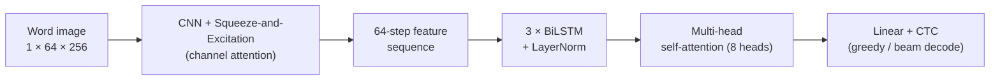

# Kannada Handwritten Word Recognition

Segmentation-free OCR that reads **whole handwritten Kannada words** from an image, using a CNN feature extractor, stacked BiLSTMs, multi-head self-attention and CTC decoding. Built in PyTorch, trained on a Tesla T4 GPU in Google Colab.

This code is part of the work published at **IEEE I3CTCON 2026** (Lonavala):
*"Hybrid Residual CNN with Convolutional Attention for Kannada Text Recognition."*

> **Which model is this?** The paper compares four architectures. This repository contains the
> **CNN-SE + BiLSTM + Multi-Head Attention** variant. The paper's final model swaps the CNN-SE
> backbone for a ResNet-CBAM backbone (see results below).

## Architecture



- **CNN + SE blocks** – extracts stroke features; SE blocks re-weight channels so the network focuses on informative curves and loops. Pooling shrinks the height to 1 but keeps 64 positions along the width, which become the time steps.
- **BiLSTM (×3)** – reads the sequence in both directions, since neighbouring Kannada glyphs and vowel signs affect each other.
- **Multi-head self-attention** – lets every position look at the whole word, which helps with compound characters (vattakshara) and overlapping strokes.
- **CTC** – learns the alignment between image columns and characters, so no character-level segmentation or labelling is needed.

Training: AdamW (lr 1e-3, weight decay 1e-4), 5-epoch warmup + cosine decay, mixed precision, gradient clipping at 5.0, early stopping (patience 20), beam search (width 5) for validation after epoch 10.

## Dataset

Kannada subset of **IIIT-INDIC-HW-WORDS** (Gongidi & Jawahar, ICDAR 2021): 6,353 word images, split 80:10:10 → 5,082 train / 635 validation / 636 test.

Preprocessing: grayscale → adaptive-threshold binarisation → noise removal → aspect-preserving resize onto a 64×256 canvas → normalisation. Training-time augmentation: rotation, translation, scale, shear, blur, noise, brightness/contrast.

## Results (test set, 636 images – from the paper)

| Model | Char acc. | Word acc. | Model size |
|---|---|---|---|
| **CNN-SE + BiLSTM + MHA** *(this repo)* | 89.30% | 74.37% | 168 MB |
| ResNet-CBAM + Transformer | 90.87% | 78.46% | 450 MB |
| ResNet-CBAM + BiLSTM + MHA *(final model)* | 91.13% | 80.03% | 312 MB |
| GCAM + BiLSTM + MHA | 92.33% | 81.60% | 720 MB |

The final model was chosen over GCAM because it trained stably at less than half the size, while GCAM's validation accuracy kept spiking and dropping.

## Project structure

```
├── model.py     # CNN-SE backbone, BiLSTM block, self-attention, full model
├── labels.py    # Kannada Unicode table, vocabulary check, greedy + beam CTC decoding
├── train.py     # dataset + augmentation, training loop, checkpointing
└── predict.py   # preprocess one image and print the recognised word
```

## Setup

```bash
pip install -r requirements.txt
```

### Expected data layout

`train.py` reads preprocessed arrays:

```
preprocessed/
├── vocabulary.json      # {"idx_to_char": {"1": "ಅ", ...}, "vocab_size": N}
├── train/images.npy     # (num_images, 64, 256) grayscale
├── train/labels.npy     # (num_images, max_len) character indices, 0 = padding
├── val/images.npy
└── val/labels.npy
```

Character indices start at 1 (0 is padding) and the CTC blank index is `vocab_size`.

## Usage

**Train** (defaults point to `/content/drive/MyDrive/kannada` for Colab; Drive is mounted automatically):

```bash
python train.py
# or locally
python train.py --data-dir data/preprocessed --out-dir models --epochs 100 --batch-size 32
```

The best checkpoint (by validation character accuracy) is saved as `enhanced_kannada_ocr_best.pth`. Trained weights are not included in this repo because of their size.

**Predict** on one word image:

```bash
python predict.py word.jpg --model models/enhanced_kannada_ocr_best.pth \
                           --vocab data/preprocessed/vocabulary.json
```

Add `--no-plot` to print the result without the matplotlib window. To display Kannada text in the plot, install a Kannada font such as Noto Sans Kannada.

## Notes

- **Character accuracy** is measured position by position against the ground truth, not with edit distance (CER).
- The beam search decoder is a simplified version: it merges a repeated character even when a blank separates the two occurrences.
- `predict.py` does not binarise the image the way the training pipeline does, so results on raw phone photos can differ from the reported numbers.

## Authors

Mahantesh S Hiremath, Hrushikesh P Karamadi, Abrar Ali Savadatti, Satish Chikkamath, Kaushik M B, Suneeta V. Budihal
Department of Electronics and Communication Engineering, KLE Technological University, Hubballi

**My contribution (Abrar Ali Savadatti):** the data preprocessing pipeline and the evaluation and comparison of the four architectures.

## Citation

```
M. S. Hiremath, H. P. Karamadi, A. A. Savadatti, S. Chikkamath, K. M. B., S. V. Budihal,
"Hybrid Residual CNN with Convolutional Attention for Kannada Text Recognition,"
IEEE I3CTCON 2026, Lonavala, India.
```

Dataset: S. Gongidi and C. V. Jawahar, "IIIT-INDIC-HW-WORDS: A Dataset for Indic Handwritten Text Recognition," ICDAR 2021.
